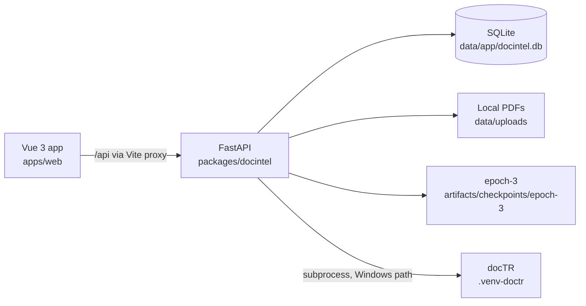
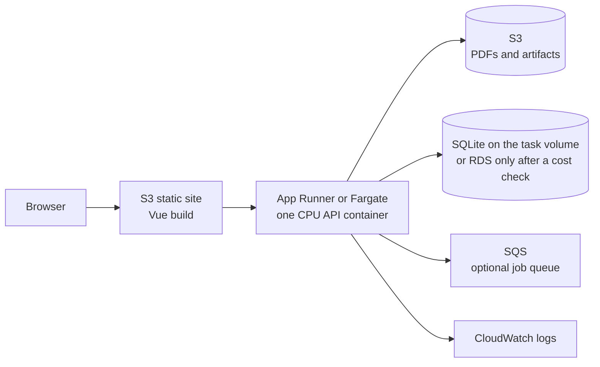

# AWS deployment architecture

This document records the current DOCILE application and a cost-conscious path to AWS. It does not create cloud resources. The frozen epoch-3 checkpoint, threshold 0.50, line-block-v2 grouping, and correction stack `stack-v1:correct+boundary+fallback` stay unchanged.

## What already runs locally

The invoice UI is `apps/web` (Vue 3.5, Vite 5, Tailwind 3, Vue Router, Axios, pdfjs-dist). `npm run build` writes `apps/web/dist`. In development, Vite on port 5173 proxies `/api` to `127.0.0.1:8080`. There is no production web server config.

The API is `docintel.api.main:app`. Invoice routes live under `/api`. Older stubs remain at `/v1/extract/sync`, `/v1/review`, and `/v1/jobs`. Those stubs are not the invoice workflow.

| Route | Role |
|---|---|
| `GET /health` and `GET /api/health` | Checkpoint presence, mode, threshold, grouping, correction version |
| `POST /api/invoices/upload` | PDF only, 20 MB limit |
| `POST /api/invoices/{id}/process` | Starts extraction |
| `GET /api/invoices/{id}/results` | Original text, corrected text, approved value |
| `PUT /api/invoices/{id}/review` | Analyst edits |
| `POST /api/invoices/{id}/approve` and `/reject` | Decision |
| `GET /api/invoices/{id}/history` | Review history |
| `GET /api/invoices/{id}/export` | JSON or CSV |
| `POST /api/invoices/{id}/compare` | Compares typed reference text. This is not a model accuracy score |

Inference loads `artifacts/checkpoints/epoch-3` through `multilabel.evaluate.load_multilabel`. `DOCINTEL_FROZEN_CHECKPOINT` defaults to `epoch-3`. Address extraction uses threshold 0.50 inside `address_pipeline.py`. `DOCINTEL_CONFIDENCE_THRESHOLD` belongs to the older FUNSD stub and is not the address threshold.

Published benchmark on the labelled 100-page set: raw exact 61/162, corrected exact 72/162. The party/address fine-tune scored 59/162 raw and 72/162 after the same stack, with customer raw exact falling from 28/70 to 26/70. That checkpoint is not selected.

New PDFs are rendered with `pypdfium2` and read by docTR in a separate virtual environment. `ocr_source.py` launches `.venv-doctr/Scripts/python.exe`, which is a Windows path. PaddleOCR is not on this path. PP-OCRv5 is a second reader used only when both reader strings are already present. With docTR alone, the reader-agreement layer does not change the text. That is the current production behavior.

Processing does not use Celery. `DOCINTEL_PROCESS_INLINE=false` starts a daemon thread inside the API process. `workers/process_job.py` is an unimplemented stub. Uploads and the SQLite database are local files. SQLAlchemy creates tables on startup. There is no migration tool.

Each processing run already stores `model_version` (`layoutlmv3-multilabel-epoch3`), `checkpoint_reference` (`docile_multilabel_full_5180/epoch-3`), `correction_version`, duration, and a configuration object with threshold, grouping, layers, OCR source, and OCR version.

## Clean-environment readiness

A fresh `pip install -e ".[dev]"` and `npm run build` do not produce a working extractor.

| Gap | Why it blocks a clean run |
|---|---|
| `pypdfium2` is imported but not declared in `pyproject.toml` | PDF page counts and page images fail |
| `experiments/` is added to `sys.path` at runtime and is not a package dependency | The API cannot import the model or the correction stack |
| docTR lives in `.venv-doctr` and is started with a Windows executable path | A Linux container cannot find it |
| `model.pt` is gitignored and is about 501 MB | The image or a mount must supply epoch-3 |
| PyTorch and Transformers are large CPU wheels | Image size and build time |
| CORS allows only `localhost:5173` | A hosted frontend cannot call the API |
| Dockerfiles in `docker/` copy neither `experiments/` nor the checkpoint | Those sketches cannot serve invoices |

The API process can start and `/health` can report `inference_mode: unavailable` when `model.pt` is missing. That is not a successful extraction.

## Recommended cloud shape

Stay on local Docker Compose until the container extracts one PDF with epoch-3. The first AWS shape, after the account is confirmed to allow it, is one CPU API service, one static frontend, and S3 for PDFs.

Choices, and why they are the small set:

| Need | Choice | Not chosen yet |
|---|---|---|
| API container | One CPU service. App Runner if the console allows it, otherwise a single Fargate task in a public subnet | EC2, GPU, a second always-on service |
| Images | ECR, one tagged image, old images deleted | Keeping every build |
| Frontend | S3 static website for the Vite build | A second container, unless the API and web must share one origin |
| PDFs | S3. The local disk path remains the development store | EFS |
| Database | SQLite on a persistent volume for the first cloud deploy | RDS, until the cost section is accepted |
| Queue | Keep the in-process thread for the first deploy. Add SQS when jobs must survive a restart | ElastiCache Redis |
| OCR | Install docTR in the API image and call it in-process | A Windows venv path, a second GPU OCR service |
| Model | Mount or copy epoch-3 read-only. Do not bake every `artifacts/` tree into the build context | Downloading a new checkpoint at request time |
| Logs | CloudWatch log group, 7-day retention | A paid APM product |
| Experiments | MLflow on the laptop, file store | SageMaker, a dedicated MLflow server |

SQS is the AWS-native stand-in for Redis and Celery. One million SQS requests per month are on the always-free allowance for accounts that can use SQS. Redis on ElastiCache is a standing monthly charge and is not required to learn the queue idea.

NAT gateways, GPU instances, and multi-AZ RDS are out of scope. A NAT gateway alone is on the order of $30 per month before traffic.

## Security

No access keys in the repository, the image, or the frontend bundle. The API task uses an IAM role that can read and write only the document bucket prefix. The frontend build receives only a public API URL (`VITE_API_URL`). Database passwords, if RDS is added later, come from the task environment or Secrets Manager, not from git. `.env` stays gitignored.

CORS must be changed to the real site origin before a hosted frontend can call the API. That is an application change and waits for approval.

## Already implemented, changes, and later work

Already implemented: invoice upload, threaded processing, epoch-3 inference, docTR for new PDFs, correction stack, analyst review, SQLite history, health payload with model and correction versions, and the published 61/162 and 72/162 benchmark.

Required before a cloud deploy, and not done in this document: declare `pypdfium2`, package `experiments/multilabel` for the image, replace the Windows docTR launcher, mount epoch-3, set CORS and `VITE_API_URL`, and add a real `.dockerignore`. The existing `docker/Dockerfile.api` and `docker/Dockerfile.worker` do not do these things.

Later, after the single container works: S3 instead of the local upload directory, SQS instead of the daemon thread, RDS if SQLite on one task is no longer enough, and CloudWatch metric filters for latency and failures. None of these change the model.
